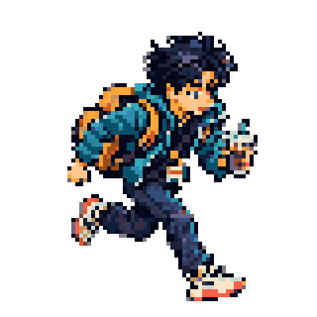
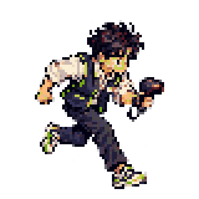
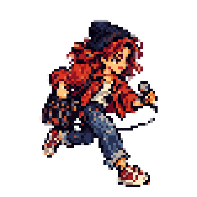
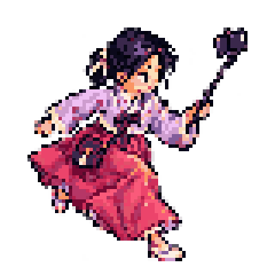
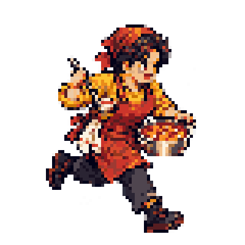
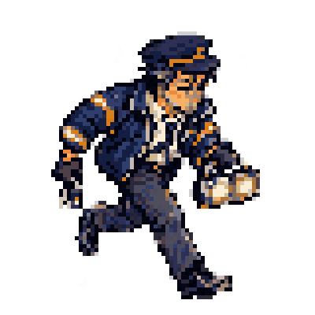

# Makcha(막차): Seoul Survivor

  
   
  <em>Last-Train Runner — coffee in hand, one transfer to go. Character concept art.</em>

> **Survive until the last train leaves.**

*Makcha* (막차) is Korean for "the last train of the night." This game is a pixel-art **survivors-like roguelite** set in real Seoul landmarks. Hold out against waves of very Seoul-specific enemies, like rush-hour crowds, rolling-suitcase stampedes and people who missed the last train, until the final departure.

The game is **open source and community-built**. Players suggest the maps, enemies, weapons and items for their own neighborhoods, the community votes, and the winners go into the game.

> **Status:** Pre-alpha / planning. No playable build yet. The name is a working title.

---

## Why this project?

**K-culture is having a moment.** K-pop, K-dramas, Korean films, food and webtoons have made Seoul a place that people around the world recognize and want to experience. We started this project to ride that wave with a game that lets players explore Seoul as locals know it: the crowded transfer stations, the late-night street food and the last-train dash, not just the postcard views.

- **For players abroad:** a playful, recognizable tour of the Seoul they've seen on screen
- **For Koreans:** the fun of seeing your own neighborhood, and its everyday chaos, turned into a game
- **For everyone:** a chance to put your corner of Seoul into the game yourself

## Concept

| | |
|---|---|
| **Genre** | Survivors-like roguelite: auto-attacks, endless waves, pick an upgrade on every level-up. One run takes 10–15 minutes. |
| **Setting** | Real Seoul landmarks, lightly parodied. The fun of seeing places you actually know. |
| **Art** | Pixel art. Gameplay uses a quarter-view (angled top-down) arena. Stage intros and boss scenes use side-view pixel illustrations with "living" backgrounds: moving crowds, flickering neon, steam from street stalls. |
| **Humor** | Everyday Seoul life turned into enemies and power-ups. |
| **Platform** | Web browser first, so there is nothing to install and runs are easy to share. |

## Stages

| Stage | Mood | Enemies | Items |
|---|---|---|---|
| **Seoul Station** *(first release)* | Night, last-train hour. The red-brick old station, the glass new station, and the Seoullo 7017 skygarden | Suitcase-dragging travelers, transfer crowds, people who missed the last train | Train lunchbox (heal), express-train dash (speed), departure board (extra time) |
| Hongdae | Night, neon, street buskers | Party zombies, flyer storms | Busker soundwave (area attack) |
| Gwanghwamun & Gyeongbokgung | Daytime, palace and plaza | Pigeon flocks, tour-group conga lines | Hanbok buff (speed) |
| Gangnam Station | Morning rush hour | Commuter crowds, late office workers | Iced Americano (attack speed) |
| Hangang Park | Sunset | Mosquito swarms, delivery scooters | Fried chicken (heal), ramyeon |
| Myeongdong | Street food and shopping crowds | Street hawkers, shopping-bag legions | Street-food combo |
| Namsan *(boss)* | Night, tower skyline | Giant Love-Lock Golem | — |

Future idea: link stations along Seoul Subway **Line 2**, a loop around the city, one stage per station.

## Characters (planned roster)

As in other survivors-likes, each character starts with one weapon and one passive bonus. Everything else comes from level-up picks.

<table>
  <tr>
    <td align="center"> Last-Train Runner</td>
    <td align="center"> Night-Shift Convenience Clerk</td>
    <td align="center"> Hongdae Busker</td>
  </tr>
  <tr>
    <td align="center"> Hanbok Traveler</td>
    <td align="center"> Street-Food Tent Owner</td>
    <td align="center"> Late-Night Taxi Driver</td>
  </tr>
</table>

_Original character concept art; animation sheets are planned._

| Character | Starting weapon | Passive |
|---|---|---|
| **Last-Train Runner** *(default)* | Transit Card Swipe: a quick "beep!" swing in the facing direction (melee sweep) | Move speed +10% |
| Night-Shift Convenience Clerk | Barcode Scanner: a straight laser through enemies (piercing) | **"1+1":** +1 projectile, like a buy-one-get-one deal |
| Hongdae Busker | Busking Amp: soundwaves pulse around the player (aura) | Area +10% |
| Hanbok Traveler | Selfie-Stick Flash: a flash on random enemies (random strike) | Pickup range +30%. Sightseeing means picking up everything. |
| Street-Food Tent Owner | Tteokbokki Broth: hot puddles on the ground (zone) | **"Have another bite":** HP regeneration |
| 🔒 Late-Night Taxi Driver | High Beams: light sweeps ahead (cone) | **"Late-night surcharge":** +20% damage after midnight |

- 🔒 Secret character: unlocked by clearing Seoul Station. Miss the last train, take a taxi.
- The MVP ships with the Last-Train Runner only. The five starting weapons above double as the MVP's five weapons, so adding the other characters later mostly means new sprites.

## Technical direction

Chosen on **23 October 2026** for a browser-first, 2D game with large enemy waves and community-created content:

| Role | Choice |
|---|---|
| Language | **TypeScript**, with strict type checking |
| Game framework | **Phaser 4**, starting prototype validation with **4.2.1** |
| Development server and build | **Vite** |

Phaser 4.2.1 is listed in the [official release archive](https://phaser.io/download/archive). The prototype will validate this baseline before the first playable release.

### Code structure

| Responsibility | Approach |
|---|---|
| Run flow | One combat Scene coordinates the start, pause, level-up choices and end of a run. |
| Gameplay | Small modules handle movement, spawning, attacks and damage. |
| Content | Typed data defines character stats, starting weapons, passives, weapon parameters and waves. All characters share the same player implementation. |
| Weapon behavior | Implement each attack pattern once, such as a piercing projectile, aura or ground zone. Tune damage, range and cooldowns through data. A new attack pattern gets its own behavior code. |
| Collision | Start with [Arcade Physics](https://docs.phaser.io/phaser/concepts/physics/arcade), using simple collision shapes. |
| Quarter-view presentation | Movement and collision use a 2D plane. Draw order follows each character's foot position to create the quarter-view appearance. |
| Repeated objects | Reuse enemies, projectiles and XP gems through object pools. |
| Art pipeline | Keep SVG source art; use transparent PNG sprite sheets for gameplay. Sprite dimensions and animation frames will be defined during the prototype. |

### First prototype and performance checks

The first playable loop uses **one character, one weapon, one enemy type and a placeholder arena**: move, auto-attack, defeat enemy waves, collect XP, choose a level-up upgrade and reach the end of a run. Check whether this loop is fun before expanding the Seoul Station content.

The proposed desktop stress-test target is **500 enemies and 300 projectiles active simultaneously at 60 FPS**. Select a reference device before testing, and record its hardware, browser, resolution, test duration and frame-rate/frame-time results. This is a validation target; no performance measurements exist yet.

Profile enemy AI, collision handling, rendering and object allocation in that prototype. Add optimizations such as spatial partitioning where measurements identify a bottleneck. Phaser 4's renderer improvements do not remove the need to measure gameplay and physics costs.

## Roadmap

- [ ] **Phase 0 – Setup:** repo, licenses, contribution and content guidelines, and a development environment for the chosen TypeScript + Phaser 4 + Vite stack
- [ ] **Phase 1 – Prototype:** the first playable loop with placeholder art, followed by the performance checks above. First question: is it fun?
- [ ] **Phase 2 – MVP: Seoul Station, Last Train:**
  - One pixel-art arena (station plaza, old station building, Seoullo 7017)
  - 1 character, 5 weapons, 5 enemies, 1 boss
  - The last-train departure time is the run timer
  - A side-view stage intro screen
  - Web release with an in-game **"Suggest your neighborhood"** button
- [ ] **Phase 3 – Community:** a weekly suggest → vote → ship cycle. The community picks the next stage.

## How content gets made

1. **Suggest:** open an issue using a content template (stage, enemy, weapon or item), or use the in-game suggestion button.
2. **Vote:** the community votes with 👍 reactions on the issue.
3. **Build:** accepted ideas are implemented with [build.interactor](https://build.interactor.com), an AI-driven software development tool, and through regular pull requests.
4. **Credit:** every accepted contributor is listed in the in-game credits and in [`CREDITS.md`](CREDITS.md).

See [CONTRIBUTING.md](CONTRIBUTING.md) for details.

## Original work only

This is an original game. Genre mechanics (auto-attacks, waves, level-up picks) are fair game. **Names, characters, art, sprites, music and sound from other games are not**, and tracing or editing them doesn't count as original. Real brand names and logos are replaced with parodies. See [CONTRIBUTING.md](CONTRIBUTING.md#original-work--ip-rules).

## License (proposed)

- **Code:** [MIT](LICENSE)
- **Art, audio and other assets:** [CC BY-SA 4.0](https://creativecommons.org/licenses/by-sa/4.0/). Credit the creator and share alike.

## Getting started

_Coming in Phase 1._ The stack is TypeScript + Phaser 4 + Vite. Build and run instructions will be added when the development environment is implemented.
